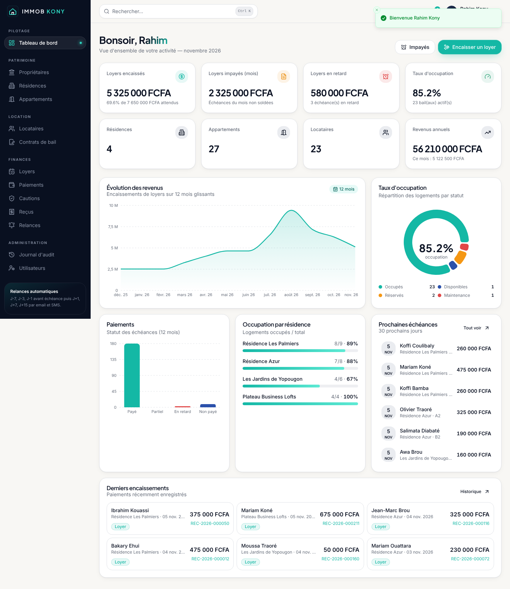
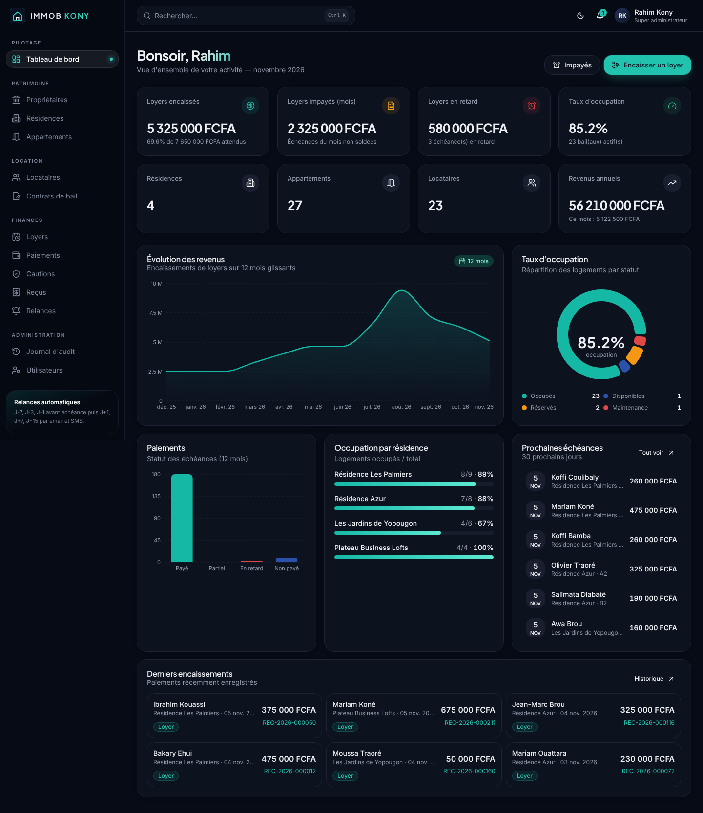
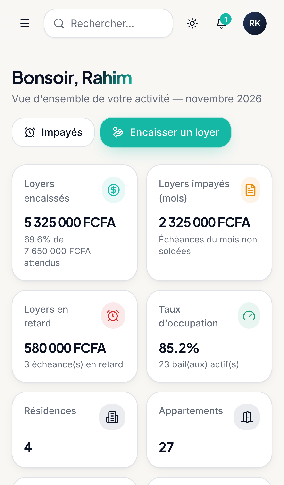
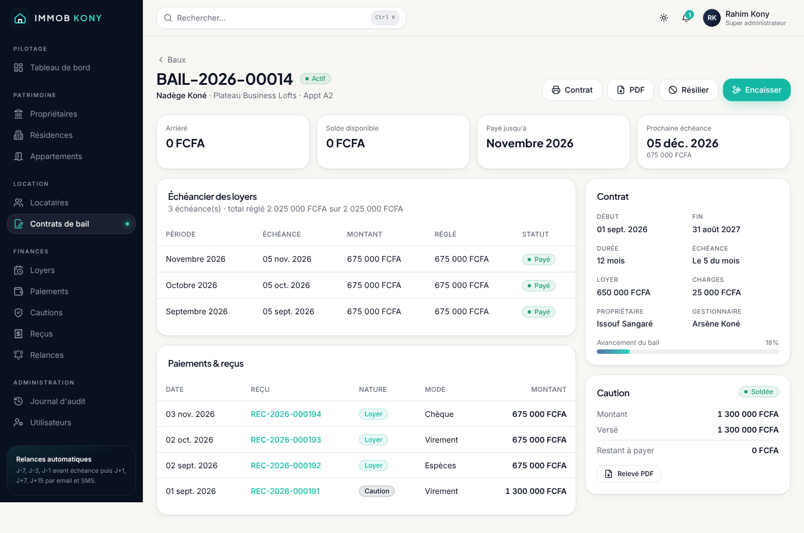
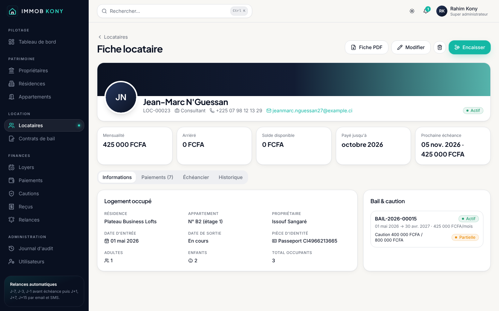

# IMMOB KONY

> Plateforme SaaS de gestion immobilière : propriétaires, résidences, appartements, locataires, baux, cautions, loyers, paiements anticipés, reçus, relances automatiques et statistiques financières.

     

| Tableau de bord | Mode sombre | Mobile |
|---|---|---|
|  |  |  |
|  |  |  |

---

## Sommaire

1. [Fonctionnalités](#fonctionnalités)
2. [Stack technique](#stack-technique)
3. [Démarrage rapide](#démarrage-rapide)
4. [Comptes de démonstration](#comptes-de-démonstration)
5. [Scripts](#scripts)
6. [Structure du projet](#structure-du-projet)
7. [Documentation](#documentation)
8. [Sécurité](#sécurité)
9. [Licence](#licence)

## Fonctionnalités

| Module | Contenu |
|---|---|
| **Tableau de bord** | KPI (résidences, appartements, locataires, loyers encaissés / impayés / en retard, taux d'occupation, revenus mensuels et annuels), graphiques interactifs (revenus 12 mois, occupation, statuts de paiement, occupation par résidence), prochaines échéances, derniers encaissements |
| **Assistant de configuration** | À la première connexion : profil gestionnaire + premier propriétaire (3 étapes) |
| **Propriétaires** | CRUD, identifiant unique `PRO-00001`, suppression logique, historique complet des modifications |
| **Résidences** | Nom, adresse, ville, commune, description, propriétaire, gestionnaire attribué, vue par étage |
| **Appartements & pièces** | Numéro, étage, surface, pièces, statut (Disponible / Occupé / Réservé / En maintenance), détail des pièces (salon, chambre, cuisine, toilette, douche, balcon, bureau) |
| **Locataires** | Photo (Cloudinary), identité, pièce d'identité (scan), date d'entrée / sortie, rattachement **à une résidence ou à un appartement**, adultes / enfants / total occupants, **fiche PDF individuelle** (photo, logement, bail, caution, historique des paiements, QR code, signature) |
| **Contrats de bail** | Génération automatique du **contrat PDF** (propriétaire, gestionnaire, locataire, résidence, appartement, loyer, durée, clauses), échéancier, résiliation |
| **Cautions** | Montant, versements, restant à payer, historique, restitution, **reçu et relevé PDF** |
| **Loyers** | Montant mensuel, échéance, date de paiement, avance, arriéré ; statuts **Payé / Partiellement payé / En retard / Non payé** |
| **Paiements anticipés** | Paiement de plusieurs mois d'avance, calcul automatique du **solde disponible** et de la **prochaine échéance** |
| **Reçus automatiques** | À chaque paiement : **reçu PDF**, **numéro unique** `REC-2026-000001`, **QR code** de vérification publique, impression, envoi email |
| **Relances automatiques** | **J-7, J-3, J-1** avant échéance, **J+1, J+7, J+15** après ; email (Resend) + SMS (passerelle prête) + notification interne ; idempotentes |
| **Recherche globale** | `Ctrl/⌘ + K` : locataires, appartements, résidences, baux, reçus |
| **Exports** | PDF, Excel (.xlsx), CSV pour chaque module |
| **Audit** | Qui a créé / modifié, quand, ancienne et nouvelle valeur, IP |
| **Utilisateurs & RBAC** | `SUPER_ADMIN` (tout) et `MANAGER` (uniquement ses résidences attribuées) |
| **UI/UX** | Design premium (bleu nuit, blanc cassé, gris premium, accent turquoise), glassmorphism léger, mode clair / sombre, responsive mobile-first, animations Framer Motion |

## Stack technique

- **Frontend** : Next.js 15 (App Router), React 19, TypeScript, Tailwind CSS, composants Shadcn UI (Radix), Framer Motion, React Hook Form, Zod, TanStack Query, Recharts, cmdk, Sonner
- **Backend** : Next.js API Routes (REST), JWT (`jose`, cookie httpOnly), RBAC, bcrypt
- **Base de données** : PostgreSQL 16 + Prisma 6 (moteur « client » sans binaire Rust + adaptateur `pg`)
- **Documents** : PDFMake (reçus, contrats, fiches, relevés, exports) + QR codes
- **Services** : Cloudinary (fichiers), Resend (emails), SMS (Twilio / passerelle HTTP)
- **DevOps** : Docker, GitHub Actions, Render (Blueprint `render.yaml`)

## Démarrage rapide

Prérequis : Node.js ≥ 20.11, PostgreSQL ≥ 14 (ou Docker).

```bash
git clone https://github.com/<votre-compte>/immob-kony.git
cd immob-kony
cp .env.example .env            # puis ajuster DATABASE_URL, JWT_SECRET…
npm install
npx prisma migrate deploy       # crée le schéma
npm run db:seed                 # charge le jeu de démonstration
npm run dev                     # http://localhost:3000
```

Avec Docker (base + application) :

```bash
docker compose up --build -d    # PostgreSQL + application, migrations appliquées au démarrage
npm install && npm run db:seed  # seed depuis l'hôte (le .env.example pointe sur localhost:5432)
```

## Comptes de démonstration

| Rôle | Email | Mot de passe | Périmètre |
|---|---|---|---|
| Super administrateur | `admin@immobkony.com` | `Admin@2026!` | Tout |
| Gestionnaire | `gestionnaire@immobkony.com` | `Gestion@2026!` | Résidence Les Palmiers, Résidence Azur |
| Gestionnaire | `a.kone@immobkony.com` | `Gestion@2026!` | Les Jardins de Yopougon, Plateau Business Lofts |

> ⚠️ Changez ces mots de passe (ou ne lancez pas le seed) en production.

Le jeu de démonstration contient 3 propriétaires, 4 résidences, 27 appartements (≈190 pièces), une vingtaine de locataires et de baux, ≈220 échéances, ≈230 paiements et reçus (dont des paiements anticipés, des retards et des cautions partielles).

## Scripts

| Commande | Rôle |
|---|---|
| `npm run dev` | Serveur de développement |
| `npm run build` / `npm start` | Build et serveur de production |
| `npm run lint` / `npm run typecheck` / `npm test` | Qualité (ESLint, TypeScript, Vitest) |
| `npm run db:migrate` | Nouvelle migration (développement) |
| `npm run db:deploy` | Applique les migrations (production) |
| `npm run db:seed` | Jeu de données de démonstration |
| `npm run db:studio` | Prisma Studio |
| `npm run cron:reminders` | Exécute les relances en ligne de commande |

## Structure du projet

```
immob-kony/
├── .github/workflows/      # CI (lint, types, tests, build, Docker) + déploiement Render
├── docs/                   # Cahier des charges, architecture, base de données, API, déploiement
├── prisma/
│   ├── schema.prisma       # Schéma complet (18 modèles, 14 énumérations)
│   ├── migrations/         # Migrations SQL versionnées
│   ├── sql/                # Script SQL de création + vues de reporting
│   └── seed.ts             # Jeu de données de démonstration
├── scripts/                # Entrée Docker, migrations, relances
├── src/
│   ├── app/
│   │   ├── (auth)/login    # Connexion
│   │   ├── (app)/…         # Espace connecté (dashboard, modules)
│   │   ├── onboarding/     # Assistant de configuration
│   │   ├── verify/[token]  # Vérification publique des reçus (QR code)
│   │   └── api/…           # API REST (≈45 routes)
│   ├── components/         # ui (shadcn), layout, dashboard, forms, shared
│   ├── hooks/              # TanStack Query, session, debounce
│   ├── lib/                # auth, rbac, api, audit, services métier, pdf, email, sms…
│   └── middleware.ts       # JWT + CSRF + redirections
├── tests/                  # Tests unitaires (Vitest)
├── Dockerfile · docker-compose.yml · render.yaml · .env.example
```

## Documentation

| Document | Contenu |
|---|---|
| [docs/01-CAHIER-DES-CHARGES.md](docs/01-CAHIER-DES-CHARGES.md) | Besoins, acteurs, règles de gestion, exigences |
| [docs/02-ARCHITECTURE.md](docs/02-ARCHITECTURE.md) | Architecture applicative, flux, sécurité, structure des dossiers |
| [docs/03-BASE-DE-DONNEES.md](docs/03-BASE-DE-DONNEES.md) | Modèle de données, diagramme entité-relation, scripts SQL |
| [docs/04-API.md](docs/04-API.md) | Référence de l'API REST |
| [docs/05-DEPLOIEMENT.md](docs/05-DEPLOIEMENT.md) | Guide de déploiement GitHub + Render pas à pas |

## Sécurité

JWT signé (HS256) en cookie `httpOnly` / `SameSite`, mots de passe **bcrypt** (12 tours), validation **Zod** sur toutes les entrées, protection **CSRF** (double-submit cookie + contrôle d'origine), **rate limiting** (API + connexion) et verrouillage de compte après 5 échecs, **RBAC** avec filtrage par périmètre au niveau des requêtes, **journal d'audit**, en-têtes de sécurité HTTP, contrôle de type binaire des fichiers téléversés, protection contre l'injection de formules CSV. Détails : [docs/02-ARCHITECTURE.md](docs/02-ARCHITECTURE.md#sécurité).

## Licence

Propriétaire — © IMMOB KONY. Tous droits réservés.
