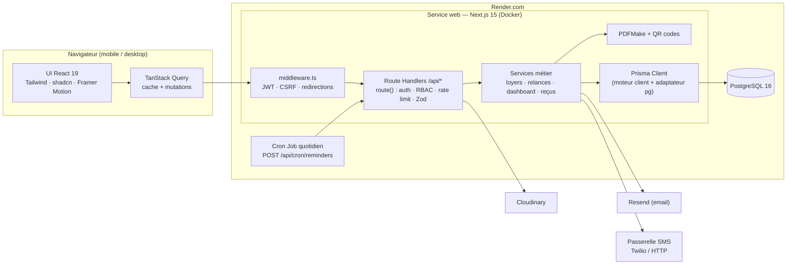
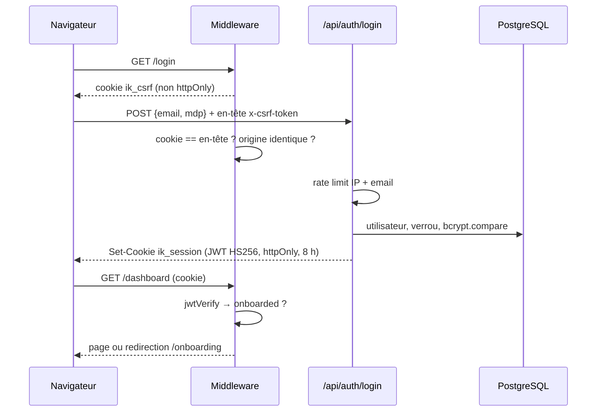
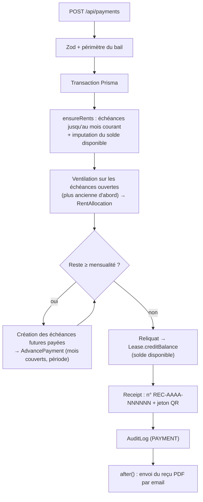

# Architecture — IMMOB KONY

## 1. Vue d'ensemble

Application **monolithique modulaire** Next.js 15 : le frontend (React Server/Client Components) et l'API REST (Route Handlers) sont servis par le même processus Node.js, ce qui simplifie le déploiement (un seul service Render) tout en gardant des frontières nettes entre couches.



## 2. Couches

| Couche | Emplacement | Responsabilité |
|---|---|---|
| Présentation | `src/app/(app)`, `src/components` | Pages, formulaires (RHF + Zod), tableaux, graphiques, thèmes |
| Accès API client | `src/lib/api-client.ts`, `src/hooks` | `fetch` + jeton CSRF, gestion d'erreurs, cache TanStack Query |
| Bordure | `src/middleware.ts` | Vérification JWT (Edge), CSRF, redirections login / onboarding |
| API | `src/app/api/**/route.ts` + `src/lib/api.ts` | Enveloppe `route()` : session, permission RBAC, limitation de débit, validation, erreurs uniformes |
| Domaine | `src/lib/services/*` | Moteur de loyers, paiements anticipés, relances, tableau de bord, reçus, rattachements |
| Transverse | `src/lib/{rbac,audit,sequence,rate-limit,errors}.ts` | Permissions, périmètres, journal d'audit, numérotation, quotas |
| Documents | `src/lib/pdf/*` | Reçus, contrats, fiches locataires, relevés de caution, exports tabulaires |
| Intégrations | `src/lib/{email,sms,cloudinary,export}.ts` | Resend, SMS, Cloudinary, CSV / Excel |
| Données | `prisma/schema.prisma`, `src/lib/prisma.ts` | Modèle, migrations, client singleton |

## 3. Flux clés

### 3.1 Authentification



### 3.2 Encaissement d'un loyer (paiement anticipé inclus)



### 3.3 Relances (tâche quotidienne)

1. `generateMonthlyRents` crée les échéances du mois pour chaque bail actif, applique les soldes disponibles, passe en **En retard** les échéances dépassées et en **Expiré** les baux échus.
2. Sélection des échéances non soldées dont la date tombe dans `[J-15 ; J+7]`.
3. Pour chaque échéance correspondant au calendrier `J-7, J-3, J-1, J+1, J+7, J+15` : création d'une `Notification` par canal (EMAIL, SMS, IN_APP). La contrainte unique `(rentId, offsetDays, channel)` garantit l'**idempotence** (relancer la tâche n'envoie rien en double).
4. Envoi via Resend / passerelle SMS, mise à jour du statut (SENT / FAILED / SKIPPED).

## 4. Sécurité

| Menace | Contre-mesure | Implémentation |
|---|---|---|
| Vol de session | JWT HS256 signé, cookie `httpOnly`, `Secure` en production, `SameSite=Lax`, expiration 8 h, `issuer`/`audience` vérifiés | `lib/auth/jwt.ts`, `lib/auth/session.ts` |
| Mots de passe | bcrypt 12 tours, politique (10 caractères, majuscule, minuscule, chiffre), comparaison à temps constant même si l'utilisateur n'existe pas | `lib/auth/password.ts`, `api/auth/login` |
| Force brute | Rate limiting IP (20 / 15 min) et email (10 / 15 min), verrouillage du compte 15 min après 5 échecs | `lib/rate-limit.ts`, `api/auth/login` |
| CSRF | Double-submit cookie (`ik_csrf` ↔ en-tête `x-csrf-token`) + contrôle de l'en-tête `Origin` sur toutes les mutations | `middleware.ts`, `lib/api-client.ts` |
| Abus d'API | Quotas par utilisateur : 600 lectures / min, 120 écritures / min + quotas par route (paiements, relances, upload) | `lib/api.ts` |
| Élévation de privilèges | Matrice RBAC `PERMISSIONS` + **filtres de périmètre appliqués dans chaque requête Prisma** (`residenceScope`, `leaseScope`…) — un identifiant hors périmètre renvoie 404 | `lib/rbac.ts` |
| Injection | Prisma (requêtes paramétrées), validation **Zod** de chaque corps de requête, échappement HTML des emails, neutralisation des formules CSV | `lib/validations`, `lib/email.ts`, `lib/export.ts` |
| Fichiers malveillants | Liste blanche MIME, taille max 5 Mo, **vérification de la signature binaire** (JPEG / PNG / WEBP / PDF), stockage Cloudinary | `api/upload` |
| Exposition de données | Page publique de reçu limitée (initiale du nom), jeton aléatoire non devinable, `robots: noindex` | `app/verify/[token]` |
| Traçabilité | `AuditLog` : utilisateur, action, entité, ancienne / nouvelle valeur (diff), IP, user-agent ; champs sensibles masqués | `lib/audit.ts` |
| En-têtes HTTP | HSTS, `X-Frame-Options: DENY`, `nosniff`, `Referrer-Policy`, `Permissions-Policy`, `poweredByHeader: false` | `next.config.ts` |
| Tâche planifiée | Secret `CRON_SECRET` comparé à temps constant | `api/cron/reminders` |
| Logs | Erreurs serveur journalisées (stdout → logs Render), audit applicatif en base | `lib/api.ts` |

> Le limiteur de débit est en mémoire (adapté à une instance). Pour plusieurs instances, remplacer le `Map` de `lib/rate-limit.ts` par Redis (Render Key Value).

## 5. Choix techniques

- **Next.js API Routes plutôt que NestJS** : un seul déploiement, typage partagé (schémas Zod communs front / back), coûts réduits. Le code métier est isolé dans `lib/services` et pourrait être extrait vers NestJS sans réécriture.
- **Prisma « client engine » + `@prisma/adapter-pg`** : pas de binaire Rust à l'exécution, image Docker plus légère, pool `pg` configurable (`DATABASE_POOL_SIZE`).
- **Montants en `Decimal(14,2)`** et dates d'échéance en `DATE` UTC : pas d'erreurs d'arrondi ni de fuseau.
- **Suppression logique** (`deletedAt`) des référentiels : l'historique et les documents restent cohérents.
- **PDF côté serveur (PDFMake)** avec polices standard : rendu identique partout, aucune dépendance navigateur.
- **TanStack Query** : cache, pagination « keepPreviousData », invalidations ciblées après mutation.

## 6. Structure des dossiers

```
src/
├── middleware.ts                  # JWT + CSRF + redirections
├── app/
│   ├── layout.tsx · globals.css   # thème, polices, fournisseurs
│   ├── (auth)/login/              # page de connexion
│   ├── onboarding/                # assistant de configuration (3 étapes)
│   ├── verify/[token]/            # vérification publique des reçus
│   ├── (app)/                     # espace connecté (layout avec sidebar + header)
│   │   ├── dashboard/             # tableau de bord analytique
│   │   ├── owners/ [id]/          # propriétaires + historique
│   │   ├── residences/ [id]/      # résidences + vue par étage
│   │   ├── apartments/ [id]/      # appartements + pièces
│   │   ├── tenants/ new/ [id]/ [id]/edit/
│   │   ├── leases/ new/ [id]/     # baux, échéancier, résiliation
│   │   ├── rents/ payments/ deposits/ receipts/ reminders/
│   │   ├── audit/ users/ settings/
│   └── api/                       # API REST (cf. 04-API.md)
├── components/
│   ├── ui/                        # primitives shadcn (button, dialog, tabs, command…)
│   ├── layout/                    # sidebar, header, recherche globale, logo
│   ├── dashboard/                 # graphiques Recharts
│   ├── forms/                     # formulaires métier (propriétaire, résidence, appartement, locataire, paiement)
│   └── shared/                    # DataTable, badges, StatCard, timeline d'audit, exports…
├── hooks/                         # useList / useCrud, useOptions, useSession, useDebounce
└── lib/
    ├── auth/ (jwt, session, password)
    ├── services/ (rent, reminder, dashboard, receipt, tenant)
    ├── pdf/ (core, documents)
    ├── validations/ (schémas Zod partagés)
    ├── api.ts · rbac.ts · audit.ts · rate-limit.ts · sequence.ts · errors.ts
    ├── email.ts · sms.ts · cloudinary.ts · export.ts · settings.ts
    └── prisma.ts · dates.ts · labels.ts · utils.ts
```

## 7. Design system

| Jeton | Clair | Sombre | Usage |
|---|---|---|---|
| `--background` | blanc cassé `#f6f5f2` | bleu nuit `#070c17` | fond |
| `--primary` | bleu nuit `#0b1222` | turquoise | actions principales |
| `--brand` | turquoise `#14b8a6` | turquoise `#2dd4bf` | accent, focus, graphiques |
| `--muted-foreground` | gris premium | gris premium | textes secondaires |
| `--sidebar` | bleu nuit profond | quasi noir | navigation |

Typographies auto-hébergées : *Plus Jakarta Sans* (titres) et *Inter* (texte). Rayons 12-16 px, ombres douces, glassmorphism léger (`.glass`), animations Framer Motion (entrées, indicateur de navigation, cartes KPI).
