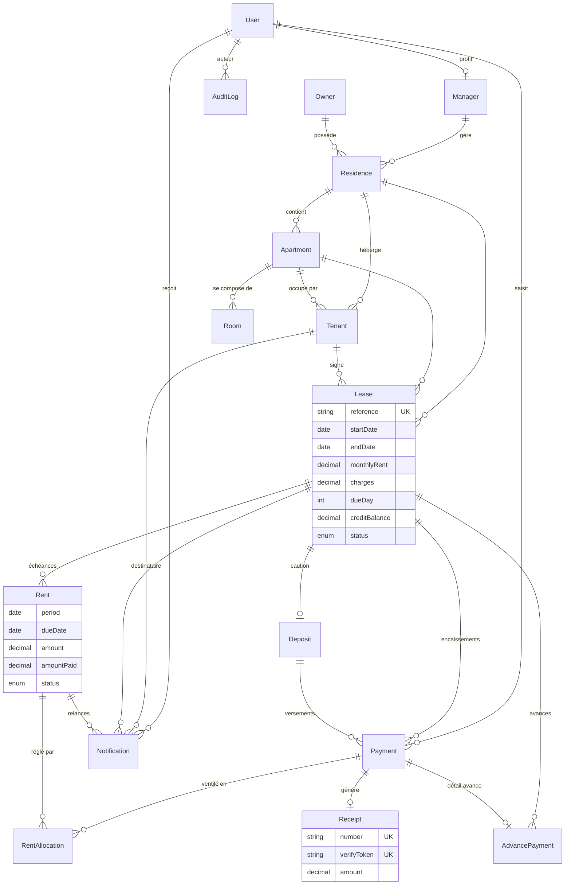

# Base de données — IMMOB KONY

PostgreSQL 16 · ORM Prisma 6 · Schéma : [`prisma/schema.prisma`](../prisma/schema.prisma)

## 1. Tables

| Table | Rôle | Points clés |
|---|---|---|
| `User` | Comptes de connexion | rôle `SUPER_ADMIN` / `MANAGER`, hash bcrypt, verrouillage, onboarding |
| `Manager` | Profil gestionnaire (1-1 avec User) | porte l'attribution des résidences |
| `Owner` | Propriétaires | code `PRO-00001`, suppression logique |
| `Residence` | Résidences | propriétaire (obligatoire), gestionnaire (facultatif) |
| `Apartment` | Appartements | unique `(residenceId, number)`, statut, loyer de référence |
| `Room` | Pièces d'un appartement | type (salon, chambre…), libellé, surface |
| `Tenant` | Locataires | rattachement résidence **ou** appartement, occupants, pièce d'identité |
| `Lease` | Baux | loyer, charges, jour d'échéance, **solde disponible** (`creditBalance`) |
| `Rent` | Échéances mensuelles | unique `(leaseId, period)`, montant, payé, statut |
| `Deposit` | Caution (1-1 avec Lease) | montant, versé, statut, restitution |
| `Payment` | Encaissements | type `RENT` / `DEPOSIT` / `ADVANCE`, mode, référence |
| `RentAllocation` | Ventilation paiement → échéances | traçabilité exacte des montants |
| `AdvancePayment` | Paiements anticipés | mois couverts, période, solde restant, prochaine échéance |
| `Receipt` | Reçus | numéro unique `REC-AAAA-NNNNNN`, jeton de vérification (QR) |
| `Notification` | Relances & notifications internes | unique `(rentId, offsetDays, channel)` → idempotence |
| `AuditLog` | Journal d'audit | ancienne / nouvelle valeur (JSON), IP, user-agent |
| `Sequence` | Compteurs atomiques | numérotation métier sans collision |
| `Setting` | Paramètres de l'agence | nom, devise, clauses par défaut, relances actives |

> Les 14 tables demandées (User, Owner, Manager, Residence, Apartment, Room, Tenant, Lease, Rent, Deposit, Receipt, AdvancePayment, Notification, AuditLog) sont complétées par `Payment`, `RentAllocation`, `Sequence` et `Setting`, nécessaires à la traçabilité financière et à la numérotation.

## 2. Diagramme entité-relation



## 3. Énumérations

| Enum | Valeurs |
|---|---|
| `Role` | SUPER_ADMIN, MANAGER |
| `ApartmentStatus` | AVAILABLE (Disponible), OCCUPIED (Occupé), RESERVED (Réservé), MAINTENANCE (En maintenance) |
| `RoomType` | LIVING_ROOM, BEDROOM, KITCHEN, TOILET, SHOWER, BALCONY, OFFICE |
| `LeaseStatus` | DRAFT, ACTIVE, TERMINATED, EXPIRED |
| `RentStatus` | PAID, PARTIAL, LATE, UNPAID |
| `DepositStatus` | PENDING, PARTIAL, PAID, REFUNDED |
| `PaymentType` | RENT, DEPOSIT, ADVANCE |
| `PaymentMethod` | CASH, BANK_TRANSFER, MOBILE_MONEY, CHECK, CARD |
| `NotificationChannel` / `Status` / `Kind` | EMAIL, SMS, IN_APP · PENDING, SENT, FAILED, SKIPPED · RENT_REMINDER_BEFORE/AFTER, PAYMENT_RECEIVED, LEASE_EXPIRING, SYSTEM |
| `AuditAction` | CREATE, UPDATE, DELETE, LOGIN, LOGOUT, EXPORT, PAYMENT |

## 4. Scripts SQL

| Fichier | Contenu |
|---|---|
| `prisma/migrations/20261105000000_init/migration.sql` | Migration initiale (appliquée par `prisma migrate deploy`) |
| `prisma/sql/01_schema.sql` | Même script, exécutable directement avec `psql` |
| `prisma/sql/02_reporting_views.sql` | Vues : `v_lease_balance`, `v_monthly_revenue`, `v_residence_occupancy`, `v_late_rents` |

```bash
# création manuelle (alternative à Prisma)
psql "$DATABASE_URL" -f prisma/sql/01_schema.sql
psql "$DATABASE_URL" -f prisma/sql/02_reporting_views.sql
```

## 5. Évolution du schéma

```bash
# modifier prisma/schema.prisma puis :
npm run db:migrate -- --name ajout_champ_x   # génère prisma/migrations/<date>_ajout_champ_x
git add prisma/migrations && git commit
# en production, la commande de pré-déploiement Render applique la migration
```

## 6. Sauvegardes

Render PostgreSQL (plans payants) : sauvegardes quotidiennes et restauration à un instant donné. Export manuel :

```bash
pg_dump "$EXTERNAL_DATABASE_URL" -Fc -f immob-kony-$(date +%F).dump
pg_restore -d "$TARGET_DATABASE_URL" --clean immob-kony-AAAA-MM-JJ.dump
```
