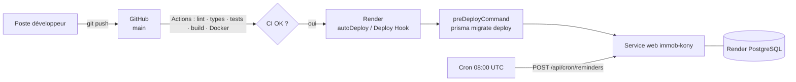

# Guide de déploiement — IMMOB KONY

Cible : **GitHub** (code + CI/CD) → **Render.com** (PostgreSQL + application Docker + tâche planifiée).



## 1. Prérequis

| Service | Usage | Indispensable |
|---|---|---|
| Compte **GitHub** | dépôt + Actions | oui |
| Compte **Render** | base + application + cron | oui |
| Compte **Resend** | emails (reçus, relances) | recommandé |
| Compte **Cloudinary** | photos, pièces d'identité | recommandé (obligatoire pour l'upload en production) |
| Domaine | adresse personnalisée + domaine d'envoi Resend | facultatif |
| Passerelle SMS | Twilio ou API HTTP (Orange, MTN, Infobip…) | facultatif |

## 2. Publier le code sur GitHub

```bash
cd immob-kony
git init
git add .
git commit -m "IMMOB KONY v1.0"
git branch -M main
git remote add origin https://github.com/<compte>/immob-kony.git
git push -u origin main
```

Le workflow **CI** (`.github/workflows/ci.yml`) s'exécute : installation, `prisma generate`, lint, typecheck, tests, migrations + seed sur un PostgreSQL de test, build, smoke test `/api/health`, puis construction de l'image Docker (poussée sur GHCR pour `main`).

## 3. Créer l'infrastructure Render (Blueprint)

1. Render Dashboard → **New → Blueprint** → connecter le dépôt GitHub.
2. Render lit `render.yaml` et propose :
   - `immob-kony-db` — PostgreSQL 16 (plan `basic-256mb`, région Frankfurt) ;
   - `immob-kony` — service web Docker (plan `starter`) avec health check `/api/health` ;
   - `immob-kony-relances` — Cron Job quotidien `0 8 * * *` (08:00 à Abidjan).
3. Renseigner les variables marquées `sync: false` :

| Variable | Valeur |
|---|---|
| `APP_URL` | `https://immob-kony.onrender.com` (ou votre domaine) — utilisée dans les QR codes |
| `RESEND_API_KEY` | clé Resend (`re_…`) |
| `EMAIL_FROM` | expéditeur d'un domaine vérifié dans Resend |
| `CLOUDINARY_CLOUD_NAME` / `_API_KEY` / `_API_SECRET` | identifiants Cloudinary |

`JWT_SECRET` et `CRON_SECRET` sont **générés automatiquement** ; `DATABASE_URL` / `DIRECT_URL` sont injectées depuis la base.

4. **Apply**. Au premier déploiement, Render construit l'image, exécute `preDeployCommand` (`/app/scripts/migrate.sh` → `prisma migrate deploy`) puis démarre `node server.js`.
5. Vérifier : `https://<service>.onrender.com/api/health` → `{"status":"ok","db":"up"}`.

## 4. Premier compte administrateur

**Option A — jeu de démonstration** (recette / démo) : depuis votre poste, avec l'URL **externe** de la base (Render → base → *Connections* ; ajoutez votre IP dans *Access Control* / `ipAllowList`) :

```bash
DATABASE_URL="postgresql://…external…" npm run db:seed
```

**Option B — production vierge** : créer uniquement l'administrateur :

```bash
DATABASE_URL="postgresql://…external…" node -e '
const { PrismaClient } = require("@prisma/client");
const { PrismaPg } = require("@prisma/adapter-pg");
const bcrypt = require("bcryptjs");
const prisma = new PrismaClient({ adapter: new PrismaPg({ connectionString: process.env.DATABASE_URL }) });
(async () => {
  await prisma.user.create({ data: { email: "vous@agence.com", passwordHash: await bcrypt.hash("MotDePasse@Fort2026", 12), role: "SUPER_ADMIN", firstName: "Prénom", lastName: "Nom" } });
  console.log("Administrateur créé"); await prisma.$disconnect();
})();'
```

À la première connexion, l'**assistant de configuration** demande le profil gestionnaire et le premier propriétaire.

## 5. Déploiement continu

- `autoDeploy: true` : chaque push sur `main` redéploie automatiquement.
- Variante « après CI uniquement » : mettre `autoDeploy: false`, copier le **Deploy Hook** (Render → service → Settings) dans le secret GitHub `RENDER_DEPLOY_HOOK_URL` ; le workflow `deploy.yml` déclenche le déploiement quand le CI réussit, puis vérifie `/api/health` (variable de dépôt `APP_URL`).

## 6. Tâche planifiée (relances)

Le Cron Job appelle :

```bash
curl -fsS -X POST -H "Authorization: Bearer $CRON_SECRET" "https://$APP_HOST/api/cron/reminders"
```

Il génère les échéances du mois, met à jour les retards, expire les baux échus et envoie les relances J-7, J-3, J-1, J+1, J+7, J+15. Exécution manuelle : bouton **« Lancer maintenant »** de la page Relances, ou *Trigger Run* dans Render.

## 7. Emails, SMS, fichiers

- **Resend** : vérifier le domaine (enregistrements DNS SPF/DKIM), puis définir `EMAIL_FROM`. Sans clé, les emails sont seulement journalisés.
- **SMS** : `SMS_PROVIDER=twilio` (+ `TWILIO_ACCOUNT_SID`, `TWILIO_AUTH_TOKEN`, `SMS_SENDER`) ou `SMS_PROVIDER=http` (+ `SMS_API_URL`, `SMS_API_KEY`) — la charge utile envoyée est `{ to, from, text }` avec `Authorization: Bearer`. Adapter `src/lib/sms.ts` au format exact de votre opérateur.
- **Cloudinary** : les fichiers sont rangés dans `immob-kony/<dossier>` ; images redimensionnées à 800 px.

## 8. Domaine personnalisé

Render → service → *Settings → Custom Domains* → ajouter `app.votre-domaine.com`, créer l'enregistrement CNAME indiqué, puis mettre à jour `APP_URL`. Le certificat TLS est automatique.

## 9. Exploitation

| Sujet | Action |
|---|---|
| Logs | Render → service → *Logs* (erreurs API, relances `[cron]`) |
| Migrations | ajoutées dans `prisma/migrations`, appliquées automatiquement avant chaque déploiement |
| Sauvegardes | quotidiennes (plans payants) + `pg_dump` manuel (cf. 03-BASE-DE-DONNEES.md) |
| Mise à l'échelle | augmenter le plan ; au-delà d'une instance, déplacer le rate limiting vers Redis (Render Key Value) |
| Rotation des secrets | modifier `JWT_SECRET` (déconnecte tout le monde) / `CRON_SECRET` (resynchronisé vers le cron) |
| Supervision | health check Render + alertes ; option : UptimeRobot sur `/api/health` |

## 10. Exécution locale avec Docker

```bash
docker compose up --build -d          # PostgreSQL + application (migrations au démarrage)
npm install && npm run db:seed        # données de démonstration depuis l'hôte
open http://localhost:3000
```

## 11. Dépannage

| Symptôme | Cause probable | Solution |
|---|---|---|
| `JWT_SECRET manquant ou trop court` | variable absente | définir ≥ 32 caractères |
| 403 « Jeton CSRF invalide » | cookie `ik_csrf` absent (appel API externe) | charger une page avant ou envoyer l'en-tête `x-csrf-token` |
| Upload « Stockage Cloudinary non configuré » | variables Cloudinary vides en production | les renseigner |
| QR code des reçus vers localhost | `APP_URL` non défini | définir l'URL publique |
| Relances non envoyées | `RESEND_API_KEY` absent ou relances désactivées (Paramètres) | vérifier la clé et l'option |
| `P1001` au déploiement | base non prête / mauvaise URL | vérifier `DATABASE_URL`, relancer le déploiement |
